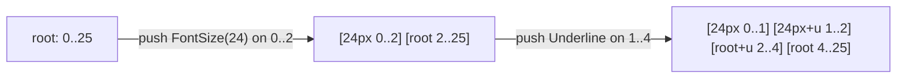
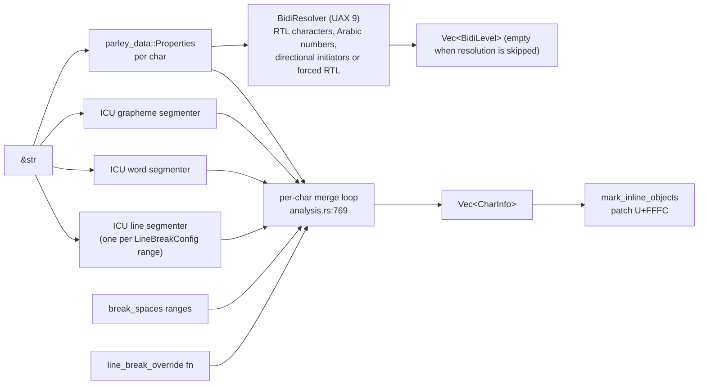
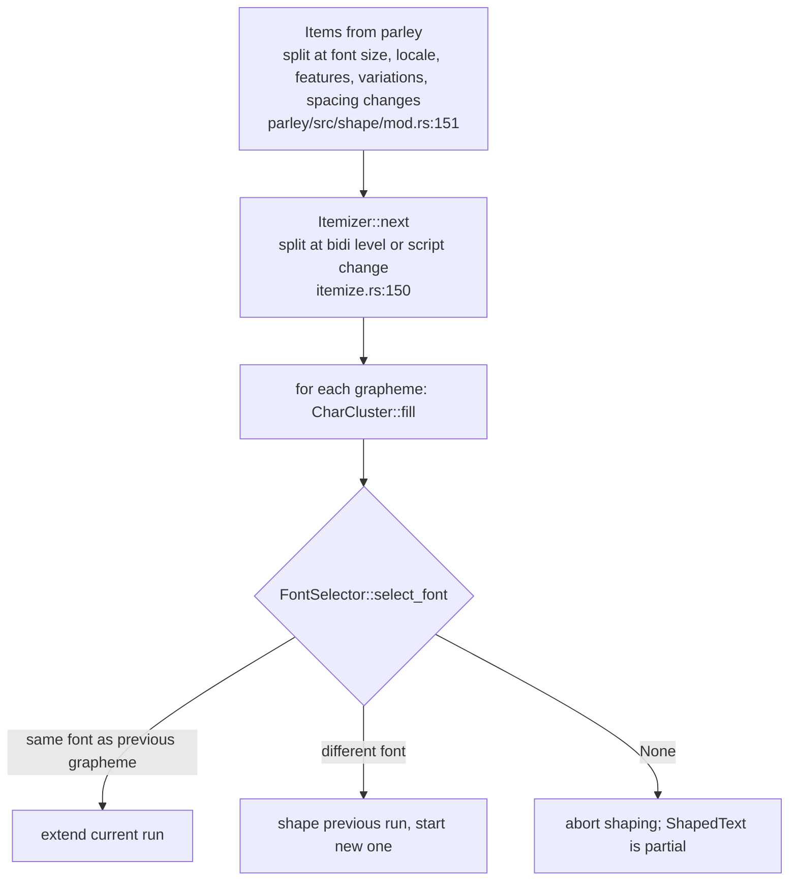
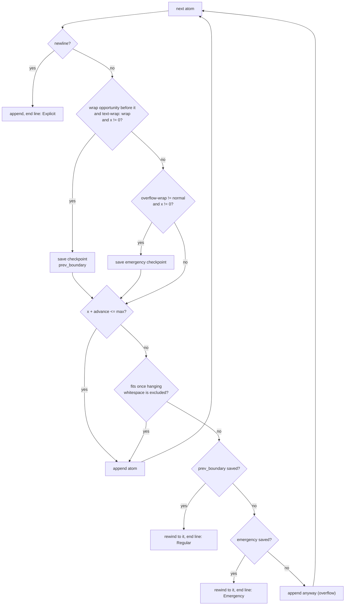
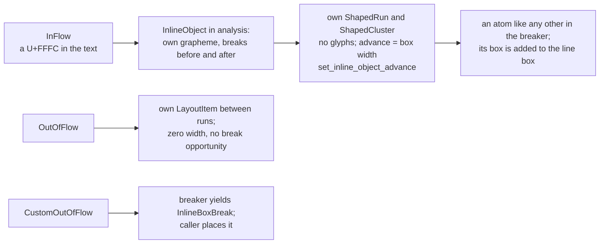

# Key algorithms

Each section below explains one algorithm, shows a diagram of its shape, and works through a real example with numbers printed by the probe programs in `scratch/probe`. After this chapter you can predict what Parley will do with a string before running it, and you know which function to read when it does something else.

The reference font sizes used throughout, all Roboto at 16px with `quantize = true`:

| text | advance |
|---|---|
| `a` | 8.70 |
| `b` | 8.98 |
| space | 3.96 |
| `cd` | 17.40 |
| `office` | 39.63 (with the `ffi` ligature) |

## Style resolution

**Purpose**: turn overlapping ranges or a tree of spans into a flat style table and non-overlapping runs.

Ranged styles (`RangedStyleBuilder::finish`, `parley/src/resolve/range.rs:75`) work like painting intervals on a number line. Start with one interval, the root style, covering the whole text. For each pushed property, `split_range` (`range.rs:189`) finds the first and last existing interval the property touches. The first and last are split if the property starts or ends inside them; the intervals fully inside are updated in place. Afterwards equal neighbours are merged, and each distinct style gets a table index, with the root forced to index 0.



Tree styles (`TreeStyleBuilder`, `parley/src/resolve/tree.rs:38`) are simpler for styles but harder for text, because the tree builder is also where CSS whitespace collapsing happens. `push_text` (`tree.rs:108`) looks at the current span's `WhiteSpaceCollapse`. Under `Collapse` or `PreserveBreaks`, runs of collapsible whitespace are not written to the text yet; they become a *pending* space that is only committed when real content follows (`flush_pending_whitespace`, `tree.rs:168`). Pending whitespace is dropped at the start of the text, after a preserved segment break and before one, which implements CSS Text 4 section 4.1.1 rules 1 to 4. The test at `tree.rs:331` lists the cases. Style ids are allocated lazily (`resolve_style_id`, `tree.rs:218`), ancestors first, which is what guarantees the parent-first order of the table.

## Analysis

**Purpose**: compute, once per character, everything about the text that does not depend on a font.

`analyze_text` (`parley_engine/src/analysis.rs:519`) merges several streams:



Points worth knowing:

- The line segmenter is configured per range of `LineBreakConfig` (`word-break`, `line-break`, language), so a `word-break: break-all` span gets its own ICU options (`SegmenterKey`, `analysis.rs:276`). Gaps between ranges use the default. When the whole text has one configuration a fast path runs the segmenter once (`analysis.rs:693`).
- A soft wrap opportunity is stored on the character *after* the break position. Mandatory breaks (newline, U+2028, U+2029) are never soft opportunities and suppress the opportunity before and after them (`analysis.rs:859`).
- `white-space-collapse: break-spaces` adds an opportunity after every preserved space or tab, which deviates from UAX 14 on purpose (`analysis.rs:830`).
- `line-break: anywhere` adds an opportunity before every grapheme (`analysis.rs:862`).
- The override callback sees three characters (`before_before`, `before`, `after`) and may force or suppress. `CHROMIUM_LINE_BREAK_OVERRIDE` (`parley_engine/src/break_overrides.rs:56`) reproduces Chromium's ASCII punctuation table, and `parley_tests/tests/linebreaking_matches_chrome.rs` checks the first-line break of thousands of generated strings against data recorded in a real Chrome.
- Word boundaries for scripts that need a dictionary (Chinese, Japanese, Thai, Khmer, Lao, Myanmar) fall back to UAX 29 rule WB999 (every grapheme is a word) when no dictionary is available (`analysis.rs:811`), because ICU4X does not do that itself.
- Bidi resolution is skipped entirely when there are no right-to-left characters (bidi classes R or AL), Arabic numbers (AN), or embedding, override or isolate initiators, and the base direction is not forced to RTL; `bidi_levels()` is then empty and every character is at the paragraph level (`analysis.rs:946`, `bidi.rs:716`).

## Bidi reordering

**Purpose**: display right-to-left text right to left, inside a line that may also hold left-to-right text.

UAX 9 assigns each character an embedding level. The engine computes levels in `BidiResolver::resolve` (`parley_engine/src/bidi.rs:52`) and itemization makes sure every shaped run has one level. Reordering happens twice, at two granularities:

1. **Within a run**, HarfRust returns RTL glyphs in visual order already, but `push_run` stores their clusters in logical order, with paint order preserved only within each cluster (`parley_engine/src/shape/shaped_text.rs:412`). `Run::visual_clusters()` walks clusters backwards for an RTL run, and the glyph iterator does the same to produce paint order across the run (`parley/src/layout/run.rs:332`).
2. **Across runs on a line**, `reorder_line_items` (`parley/src/layout/line_break.rs:1983`) implements UAX 9 rule L2: from the highest level down to the lowest odd level, reverse every maximal sequence of items at or above that level.

Worked example from the walkthrough, line 1 at width 80:

| item | text | level |
|---|---|---|
| 0 | `Hi` | 0 |
| 1 | space | 0 |
| 2 | `مرحبا` | 1 |
| 3 | space | 0 |

Highest level 1, lowest odd level 1. One pass at level 1 reverses the single-item sequence `[2]`, which changes nothing. Visual order equals logical order at the item level, and only the glyphs inside item 2 run right to left. With two adjacent Arabic runs (say a font change inside the word) the sequence `[2, 3]` would be reversed, putting the second run on the left.

A known gap, noted in the code: UAX 9 rule L1 (trailing whitespace takes the paragraph level) is not applied, so trailing whitespace only hangs when its run already has the paragraph level (`line_break.rs:1908`).

## Itemization and font selection

**Purpose**: cut the text into pieces HarfRust can shape with one font, one direction and one script, and choose that font.



Parley's `FontSelector` (`parley/src/shape/mod.rs:303`) does the following per grapheme:

1. If the style changed or the grapheme is emoji, reconfigure the fontique `Query` with the style's family list (plus the `Emoji` generic family for emoji) and attributes (width, weight, style).
2. Ask the query for candidates in order: the named families, then the fallback families for the segment's script and language (`Query::set_fallbacks`, `fontique/src/collection/query.rs:96`), which always also include a Han fallback as a workaround for common-script punctuation (`#597`).
3. Take the first font whose charmap covers every character that "contributes to shaping" (`Coverage::is_complete`, `parley_engine/src/shape/cluster.rs:207`), trying the NFC and NFD forms of the grapheme too (`calculate_coverage`, `cluster.rs:353`). If none covers it fully, take the best partial coverage, and if nothing covers anything, the first candidate.
4. If the query yields no font at all, scan the generic families for any font (`any_font`, `mod.rs:447`), so that shaping can proceed and the layout at least has metrics.

Within a family, fontique's `match_fonts` (`fontique/src/matching.rs:12`) runs the CSS Fonts 4 matching algorithm: width first, then style (with a 14 degree oblique threshold), then weight. When no face matches, `Synthesis` records whether to embolden or skew, and HarfRust is told to apply a variation or the renderer to fake it.

## Shaping

**Purpose**: turn a run of characters into positioned glyphs, with the font's rules (ligatures, kerning, Arabic joining, mark placement).

`shape_run` (the closure at `parley_engine/src/shape/shaper.rs:287`) does:

1. Look up or create three cached HarfRust objects: `ShaperData` per font, `ShaperInstance` per font and variation setting, `ShapePlan` per font, direction, script, language, features and coordinates (`shaper.rs:293`). The caches are 16-entry LRUs.
2. Fill a `UnicodeBuffer` one `char` at a time with the character's index within the run as its cluster value (`shaper.rs:351`), so that HarfRust's output cluster values map straight back to `Character` rows. The text before and after the run is given as context so that joining across run boundaries is right (`shaper.rs:362`, from `#740`). This does not preserve kerning between glyphs in separate runs.
3. Shape with `MonotoneCharacters` cluster level, which lets a grapheme be split into several clusters when the font does not combine base and mark.
4. `push_run` (`shaped_text.rs:308`) copies the characters, computes `FontMetrics` with skrifa, and `process_shaped_clusters` (`shaped_text.rs:505`) groups glyphs by HarfRust cluster value into `ShapedCluster`s.

Two special cases in `process_shaped_clusters`: a cluster whose first character is a newline or an inline object gets zero glyphs and zero advance (`shaped_text.rs:542`); a cluster with exactly one glyph at zero offset stores the glyph id inline instead of in the glyph array (`shaped_text.rs:546`). The walkthrough's "glyphs (stored): 2" for 18 clusters shows how common the second case is.

## Line breaking

**Purpose**: fit atoms into lines no wider than `max_advance`, breaking only where analysis allowed it, and record what each line holds.

Parley's breaker is **greedy with one level of backtracking**, the same strategy browsers use for `text-wrap: wrap`. There is no paragraph-wide optimisation (no Knuth-Plass).



This is `BreakLines::break_next` (`parley/src/layout/line_break.rs:1083`). The state it keeps is `BreakerState` (`line_break.rs:636`): the current item, run and shaped cluster index, the line's running `x`, the line box metrics so far, and the two saved checkpoints (`PrevBoundaryState`, `line_break.rs:556`). A checkpoint is a copy of `LineState` plus lengths of two side vectors, so that saving is cheap.

Worked example, the walkthrough at width 80. Atoms and the running x:

| atom | advance | x after | note |
|---|---|---|---|
| `H` | 17.11 | 17.11 | |
| `i` | 5.82 | 22.93 | |
| space | 3.96 | 26.89 | |
| `م` | 9.18 | 36.07 | wrap opportunity before it: checkpoint saved at x = 26.89 |
| `ر` `ح` `ب` `ا` | 25.54 | 61.61 | |
| space | 3.96 | 65.58 | |
| `o` | 9.12 | 74.70 | wrap opportunity: checkpoint moved to x = 65.58 |
| `ffi` | 13.66 | 88.36 > 80 | does not fit, does not hang: rewind to the checkpoint |

The line ends after the second space with `BreakReason::Regular`, advance 65.58, and the breaker continues from `o`. Breaks always fall on atom boundaries, so `ffi` can never be split: "Breaking an atom requires reshaping, which we don't do here" (`line_break.rs:1227`).

Details that trip people up:

- `text_wrap_mode` is read with a one-atom lag (`line_break.rs:1188`): the opportunity *before* an atom belongs to the text before it, so the previous atom's `nowrap` is what should suppress it.
- A checkpoint is never saved at `x == 0`, so an atom that is wider than the line is placed anyway and overflows instead of producing an empty line (`line_break.rs:1213`).
- Emergency breaks (`overflow-wrap: anywhere` or `break-word`) are saved at every atom and only used when no regular checkpoint exists on the line (`line_break.rs:1293`).
- When `max_advance` is `None`, `break_all_lines` passes `f32::MAX` (`layout.rs:230`) and every line's `inline_max_coord` is later set to the widest line (`line_break.rs:1663`), so that alignment has something to align to.
- `break_next_with_length` (`line_break.rs:1348`) is an alternative breaker by character count, used by callers that paginate by characters.
- The low-level API yields back to the caller for `CustomOutOfFlow` boxes and when a per-line maximum height is exceeded (`YieldData`, `line_break.rs:569`); `break_remaining` handles the first by placing a zero-sized box so that the loop makes progress (`line_break.rs:1459`).

When a line is committed, `commit_line` (`line_break.rs:1690`) writes the `LineItemData`s with their narrowed cluster ranges, computes the text range, measures hanging whitespace, counts justification opportunities, and reorders the items for bidi. `start_new_line` then calls `finish_line` for the vertical metrics (next section but one).

## Hanging whitespace

**Purpose**: let trailing spaces stick out past the line's end so that a line that is "full plus a space" still fits, following CSS Text 4 section 4.3.2.

Which whitespace hangs is decided per character by `whitespace_hangs` (`parley/src/layout/whitespace.rs:61`):

| whitespace | `collapse` or `preserve-breaks` | `preserve` | `break-spaces` |
|---|---|---|---|
| newline | hangs | hangs | hangs |
| space, tab, ideographic space U+3000 | hangs | hangs only with `text-wrap: wrap` | never |
| no-break space U+00A0 | never | never | never |
| other | never | never | never |

The amount is computed once per committed line by `hanging_whitespace` (`line_break.rs:1882`), walking atoms backwards from the logical end. There are two flavours:

- **Unconditional**: the whitespace hangs in full. This is the case for every soft-wrapped line (the `overflow` passed in is `f32::INFINITY`, `line_break.rs:1806`).
- **Conditional**: only before a forced break or the end of the text, and only for `preserve` whitespace: it hangs only as far as it overflows the line (`line_break.rs:1807`). Whitespace that fits stays in the line and counts towards the width.

The module docs at `whitespace.rs:6` explain how the two combine: the trailing whitespace is a conditionally hanging suffix preceded by unconditionally hanging whitespace, and the unconditional part only hangs if the conditional suffix hangs in full (CSS Text 4 section 9.2).

Numbers from `cargo run --bin spacing`, text `"ab   cd"` (three spaces) at width 30:

| mode | lines | line 1 advance | hanging | `layout.width()` |
|---|---|---|---|---|
| `Collapse` | 2 | 29.56 | 11.88 | 17.68 |
| `Preserve` | 2 | 29.56 | 11.88 | 17.68 |
| `BreakSpaces` | 2 | 29.56 | 0.00 | 29.56 |

`ab` is 17.68 and the three spaces are 11.88. Under `Collapse` and `Preserve` the spaces hang (the line was soft-wrapped, so unconditionally) and the layout width excludes them. Under `BreakSpaces` nothing hangs, and `cd` still moved to the next line because 29.56 + 17.40 > 30.

Conditional hanging with `"ab   \ncd"` under `Preserve`:

| width | hanging | `layout.width()` |
|---|---|---|
| 60 | 0.00 | 29.56 |
| 24 | 5.56 | 24.00 |
| 20 | 9.56 | 20.00 |

The spaces precede a forced break, so they hang only by the overflow: 29.56 - 24 = 5.56 and 29.56 - 20 = 9.56. The layout width is exactly the available width.

Hanging whitespace also removes itself from justification: `num_justification_opportunities` subtracts the word separators that hang (`line_break.rs:1816`), and `justification_end_cluster` marks where stretching stops.

## The line box and vertical alignment

**Purpose**: give each line a height and a baseline, following CSS 2.2 section 10.8 and CSS Inline 3.

Every style's span box is computed once per layout by `resolve_style_metrics` (`parley/src/layout/style_metrics.rs:106`). `BoxMetrics::from_font` (`style_metrics.rs:228`) turns a font's ascent and descent plus a resolved line height into `over` and `under`:

```text
half_leading = (line_height - (ascent + descent)) / 2
over  = ascent + half_leading          (floored when quantizing)
under = line_height - over
```

With `line-height: normal` (`LineHeight::MetricsRelative(1.0)`), the line height is ascent + descent + leading and the half-leading is leading / 2. Roboto has zero leading, so at 16px: ascent 15, descent 4, line height 19, over 15, under 4. Measured for `"Hi"`:

| `LineHeight` | line height | baseline | content block |
|---|---|---|---|
| `MetricsRelative(1.0)` | 19 | 15 | 0..19 |
| `FontSizeRelative(1.5)` | 24 | 17 | 2..21 |
| `Absolute(40)` | 40 | 25 | 10..29 |

For `FontSizeRelative(1.5)`: 24 - 19 = 5, half 2.5, floored to 2, baseline 15 + 2 = 17. The content block (ascent to descent, 2..21) is what glyphs actually cover; the line box (0..24) is what stacks.

On each line, `LineBoxMetrics` (`line_break.rs:113`) accumulates boxes as atoms are appended:

- the **strut**, the root style's span box, is always present (`reset_line`, `line_break.rs:943`);
- the span box of each style whose text is on the line, and all of its ancestors (`add_style`, `line_break.rs:357`);
- the **run box** of each run, from the actual font used, but only under `line-height: normal` (`run_box_metrics`, `data.rs:56`); this is how a fallback font grows a line;
- each inline box.

`vertical-align` moves a box's baseline relative to its parent's (`shift_from_parent`, `style_metrics.rs:287`): `sub` lowers by a fifth of the parent's font size, `super` raises by a third, `text-top` and `text-bottom` align to the parent's content area, `middle` to half the parent's x-height, and a length is added directly. Those offsets are summed down the style tree once per layout (`exact_baseline_offset`, `style_metrics.rs:162`). `top` and `bottom` are different: they align to the line box, so the box and everything inside it form an **independent aligned subtree** whose position is only known when the line is complete (`finish_line`, `line_break.rs:1546`). The module docs at `style_metrics.rs:14` have the full explanation and a tree example.

Measured: `"x2y"` with `2` at 10px and `VerticalAlign::SUPER`:

```text
line baseline 15, line_height 19
glyph run style 0 size 16 baseline 15.00
glyph run style 1 size 10 baseline 10.00
glyph run style 0 size 16 baseline 15.00
```

The superscript baseline is 15 - round(16 / 3) = 15 - 5 = 10. The small box did not grow the line because its top (10 - round(9.28) = 1) is inside the strut.

## Alignment and justification

**Purpose**: position each line within its available width.

`align` (`parley/src/layout/alignment.rs:69`) runs once per call over all lines and only writes two fields per line: `LineMetrics::offset` and `LineData::justification.amount_per_opportunity`. Nothing else changes, which is why re-aligning is cheap.

```text
free_space = (inline_max_coord - inline_min_coord) - indent - advance + hanging_advance
Start / Left (LTR):  offset = indent
End / Right (LTR):   offset = indent + free_space
Center:              offset = indent + free_space / 2
Justify:             amount_per_opportunity = free_space / num_justification_opportunities
```

The last line of each paragraph (break reason `None` or `Explicit`) uses `last_line_alignment`, which defaults to `Start` when justifying, matching CSS `text-align-last: auto` (`alignment.rs:105`). Overflowing lines are start-aligned unless `align_when_overflowing` is set.

Measured: `"aa bb cc dd ee"` at width 60 breaks as `aa bb ` plus `cc dd ee`.

| alignment | line 1 offset | line 1 space advances | line 2 offset |
|---|---|---|---|
| `Start` | 0 | 3.96, 3.96 (hanging) | 0 |
| `Justify` | 0 | **24.64**, 3.96 (hanging) | 0 (last line is start-aligned) |
| `End` | 20.68 | 3.96, 3.96 | 0.33 |

Free space on line 1 is 60 - 43.28 + 3.96 = 20.68. There is one justification opportunity (the interior space; the trailing one hangs), so it grows to 3.96 + 20.68 = 24.64 and the run's advance becomes 63.96, which is 60 plus the hanging 3.96. The stretch is applied when the space's atom is read: `EffectiveSpacing::gaps` adds `amount_per_opportunity` to word separators before `justification_end_cluster` (`spacing.rs:191`).

## Letter spacing and word spacing

**Purpose**: CSS `letter-spacing` and `word-spacing`.

Both are stored on the run as `Spacing` (`spacing.rs:73`) and applied *visually after* each atom (`Gaps::after`), which is what Blink does; Gecko applies logically after, and the CSS working group has discussed the difference (`spacing.rs:67`). Word spacing is added after atoms that are word separators, which Parley defines as space and no-break space (`is_word_separator`, `spacing.rs:18`). Letter spacing is skipped after default-ignorable characters such as zero-width spaces, matching Blink (`spacing.rs:107`, `#924`).

Measured on `"ab cd"`:

| letter | word | cluster advances | width |
|---|---|---|---|
| 0 | 0 | 8.70 8.98 3.96 8.38 9.02 | 39.04 |
| 2 | 0 | 10.70 10.98 5.96 10.38 11.02 | 49.04 |
| 0 | 5 | 8.70 8.98 8.96 8.38 9.02 | 44.04 |
| 2 | 5 | 10.70 10.98 10.96 10.38 11.02 | 54.04 |

Every atom, including the last and the space, gets the letter gap; the space additionally gets the word gap.

Letter spacing changes shaping too: when it is non-zero, Parley passes the OpenType features `liga`, `clig`, `dlig`, `hlig` set to 0 so that optional ligatures do not form (`OPTIONAL_LIGATURES_OFF`, `parley/src/shape/mod.rs:37`), following CSS Text 3 section 7.2. Measured on `"office"`:

```text
letter 0: "ffi" is one glyph 446, advance 13.66 (4.55 per grapheme), width 39.63
letter 1: "f" "f" "i" are glyphs 74, 74, 77 with advances 6.55 6.55 4.88, width 46.97
```

## Content widths

**Purpose**: CSS `min-content` and `max-content` without laying out.

`calculate_content_widths` (`parley/src/layout/data.rs:418`) runs `ContentWidthsMeasurer` over the shaped clusters without touching lines. Max-content is the widest run of text between forced breaks. Min-content is the widest fragment between soft wrap opportunities. Hanging whitespace is treated as the line breaker would: conditionally hanging whitespace counts towards max-content (it would fit) but not min-content (`data.rs:409`). The max is floored by the min for negative-width inline boxes (`data.rs:555`). Whenever you change the line breaker's hanging rules, change the measurer too; the two must agree, and `parley_tests/tests/content_widths.rs` and `whitespace.rs` check that they do.

From the walkthrough: `min 43.75 max 109.33`, which are `office!` and the whole first paragraph.

## Inline boxes

**Purpose**: reserve space in the text for something that is not text (an image, a widget), or position something at a text offset without reserving space.



Since `#902`, an in-flow box must sit on a U+FFFC OBJECT REPLACEMENT CHARACTER at `InlineBox::index`; `build_into_layout` asserts this (`parley/src/builder.rs:434`). The `TreeBuilder` inserts the character for you (`builder.rs:342`). The box's width becomes the cluster's advance (`place_inline_object`, `data.rs:292`), so hit testing and selection treat it like one big character. Its vertical placement follows `vertical_align` against the containing span (`inline_box_placement`, `style_metrics.rs:330`), and `Layout::edit_inline_box` lets you change its size later and re-break.

Out-of-flow boxes are `LayoutItem`s of their own, inserted in logical order between runs with the bidi level of the previous run (`shape/mod.rs:217`), take no space and create no break opportunity (`#797`).

## Hit testing and cursor movement

**Purpose**: map a point to a text position and move a caret by graphemes, words and lines.

`Cluster::from_point` (`parley/src/layout/cluster.rs:77`) finds the line by y (`Layout::line_for_offset`, `layout.rs:273`), then walks the line's runs and visual clusters accumulating advances until x is passed. It returns the cluster and whether the hit was on its left or right half. The non-exact variant snaps to the nearest cluster when the point is past the end, which is what text selection wants.

`Cursor::from_point` (`parley/src/editing/cursor.rs:38`) converts that into a byte index and affinity: a hit on the left half of an LTR cluster gives the cluster's start with `Downstream` affinity, on the right half its end with `Upstream`; RTL clusters are mirrored (`cursor.rs:41`). `Cursor::geometry` (`cursor.rs:279`) goes back to a rectangle, using the affinity to pick a side at soft line breaks.

Visual movement (`next_visual`, `cursor.rs:133`) asks for the two clusters that visually bound the caret (`visual_clusters`, `cursor.rs:327`) and steps to the far edge of the right one, with special cases at soft line breaks so that the caret visits both the end of one line and the start of the next. Word movement repeats visual steps until a word boundary that is not whitespace (`next_visual_word`, `cursor.rs:174`). Line movement remembers the horizontal position and hit-tests the middle of the target line (`Selection::move_to_line`, `selection.rs:283`).

From the walkthrough: bytes 3 and 13 both have x = 61.61 on line 1, which is the right edge of the Arabic word and the left edge of the following space. The affinity is what lets the editor show the caret at the right place when the user arrives there from the left versus from the right.

Selection rectangles (`Selection::geometry_with`, `selection.rs:503`) are computed per line: full lines get one rectangle from the line's offset to its advance; the first and last lines walk visual clusters and merge consecutive selected clusters into rectangles, so a selection across a bidi boundary can produce several rectangles on one line.
