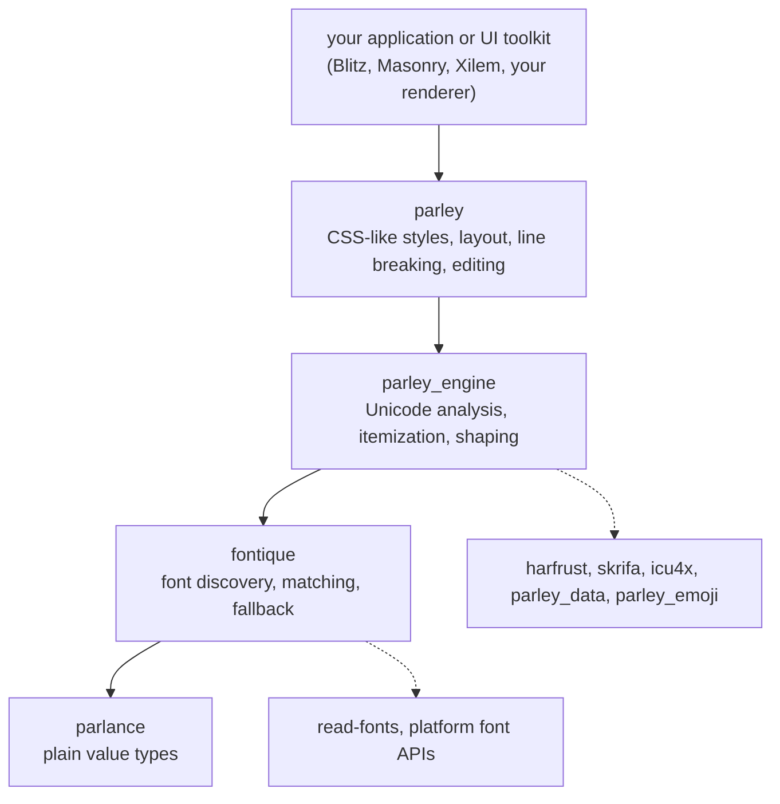

# Architecture map

This chapter is written in the style of rust-analyzer's architecture document: a bird's-eye view, then a map of the code with what each part owns and what it must never know about, then a "where to find X" table. Read it once now and come back to it whenever you need to find something.

## Bird's eye view

Parley is a four-layer stack. Each layer only looks down.

The boundary that matters most is between `parley` and `parley_engine`. The engine takes a `&str`, some options, a stream of `Item`s and a `FontSelector`, and gives back a `ShapedText`. It does not know what a `StyleProperty` is; it only sees a `u16` per character that it copies through (`parley_engine/src/shape/shaper.rs:154`, where the parameter is literally commented as a candidate for renaming to `user_data`). Everything about CSS (line height, vertical-align, whitespace rules, alignment, spacing) is in `parley`.

## Crate by crate

### `parlance`: vocabulary

- **Purpose**: tiny, `no_std`, dependency-free value types shared by every other crate: `FontWeight`, `FontWidth`, `FontStyle`, `FontFamily`, `FontFamilyName`, `GenericFamily`, `Language`, `Script`, `Tag`, `FontFeature`, `FontVariation`, `BidiLevel`, `BaseDirection`, `NormalizedCoord`, `LineBreak`, `WordBreak`, `OverflowWrap`, `TextWrapMode` (`parlance/src/lib.rs:62`).
- **Owns**: parsing of CSS-shaped strings (`FontFamilyName::parse_css_list`, `FontFeature::parse_css_list`, `Language::parse`).
- **Must not know about**: fonts as data, text, layout. If a type needs to open a font file it does not belong here.
- **Entry point**: the re-exports in `parlance/src/lib.rs`.

### `fontique`: fonts

- **Purpose**: answer "which font file and face index should I use for these attributes, this script and this language", and load it.
- **Owns**: `Collection` (`fontique/src/collection/mod.rs:66`), the set of families and faces, from the system backends (`fontique/src/backend/`: CoreText, DirectWrite, fontconfig, Android, a dummy) and from `register_fonts`; `Query` (`fontique/src/collection/query.rs:35`), the stateful matcher; the CSS font matching algorithm (`fontique/src/matching.rs:31`); `FallbackMap` from script and locale to families (`fontique/src/fallback.rs:15`); `SourceCache` (`fontique/src/source_cache.rs:38`) for memory-mapped font data; `Synthesis` (`fontique/src/font.rs:347`), the request to fake bold or italic when no real face exists.
- **Must not know about**: Unicode text analysis, glyphs, shaping. It compares `Charmap` coverage one `char` at a time and nothing more.
- **Key fact**: a `Query` borrows the collection's internals, its query state and the `SourceCache` mutably for its whole life (`query.rs:36`). That is why `FontContext` and `LayoutContext` are passed around as `&mut` everywhere.

### `parley_data` and `parley_emoji`: Unicode tables

- `parley_data` packs script, general category, grapheme cluster break, bidi class and nine boolean properties for every code point into one `u64` lookup (`parley_data/src/lib.rs:53`), generated from ICU4X data by `parley_data_gen`. One lookup per character instead of nine.
- `parley_emoji` is a translation of Christian Hansen's `c-emoji` state machine that decides whether a grapheme is presented as emoji (`parley_emoji/src/lib.rs:7`). It is MIT-only and documented as an internal detail.

### `parley_engine`: analysis and shaping

- **Purpose**: turn a `&str` into glyphs, with every Unicode decision made, but no layout decisions.
- **Entry points**: `Analyzer::analyze` (`parley_engine/src/analyzer.rs:42`) and `Shaper::shape_text` (`parley_engine/src/shape/shaper.rs:150`). The crate docs at `parley_engine/src/lib.rs:7` have a complete example.
- **Owns**:
  - `analysis.rs`: `Analysis`, `CharInfo`, `DictionaryProvider`, `AnalysisDataSources`, and `analyze_text`, which merges ICU4X's line, word and grapheme segmenters with Parley's own rules (break-spaces, `line-break: anywhere`, overrides, inline objects).
  - `analyzer.rs`: the option types `AnalysisOptions`, `LineBreakConfig`, `InlineObject`.
  - `bidi.rs`: a full UAX 9 implementation, private since `#891`.
  - `itemize.rs`: `Item`, `Segment`, `Itemizer`.
  - `shape/shaper.rs`: `Shaper`, `ShapeOptions`, `FontInstance`, `FontSelector`, `shape_segment`, and the three LRU caches for HarfRust shaper data, instances and plans (`shaper.rs:88`).
  - `shape/cluster.rs`: `CharCluster`, the grapheme being font-matched, with NFC and NFD normalisation attempts (`cluster.rs:353`), `Coverage`, and the `Whitespace` enum.
  - `shape/shaped_text.rs` and `shape/data.rs`: the output types.
  - `shape/atom.rs`: `ShapedSlice`, `Atom`, `Grapheme` and their cursors.
  - `break_overrides.rs`: `LineBreakOverrideFn` and `CHROMIUM_LINE_BREAK_OVERRIDE`.
- **Must not know about**: styles beyond `ShapeOptions` and the opaque `u16`, lines, alignment, pixels (it does know `font_size` because HarfRust scales by it).
- **Invariant it enforces**: `ShapedText::characters` covers every char of the input, unless the `FontSelector` returned `None`, in which case shaping aborts and the result is partial (`shaper.rs:205`).

### `parley`: styles, layout, editing

- **Purpose**: the web-style layer. Styles in, positioned glyph runs out, plus editing.
- **Entry points**: `LayoutContext::ranged_builder`, `tree_builder`, `style_run_builder` (`parley/src/context.rs:99`), then `Layout::break_all_lines` and `Layout::align`.

Module map, in pipeline order:

| Module | Purpose | Key items | Must not know about |
|---|---|---|---|
| `style/` | the public style vocabulary | `StyleProperty`, `TextStyle`, `LineHeight`, `VerticalAlign`, `WhiteSpaceCollapse`, `StyleSet`, `Brush` | layout data, fonts as data |
| `resolve/` | turn styles into a table and runs | `ResolveContext`, `ResolvedStyle`, `RangedStyleBuilder` (`range.rs`), `TreeStyleBuilder` (`tree.rs`, also does whitespace collapsing) | shaping, lines |
| `builder.rs`, `context.rs`, `font.rs` | the builders and the two contexts; `build_into_layout` (`builder.rs:402`) is the build-phase driver | `RangedBuilder`, `TreeBuilder`, `StyleRunBuilder`, `LayoutContext`, `FontContext` | line breaking internals |
| `analysis.rs` | adapt styles to `AnalysisOptions` | `analyze_text` collects `LineBreakConfig` and `break-spaces` ranges from style runs | the layout |
| `shape/mod.rs` | itemize on styles, select fonts, drive the engine | `shape_text`, `FontSelector`, `OPTIONAL_LIGATURES_OFF`, `any_font` | lines |
| `inline_box.rs` | inline boxes | `InlineBox`, `InlineBoxKind`, `LayoutInlineBox` | shaping |
| `layout/data.rs` | the layout's storage and content widths | `LayoutData`, `RunData`, `LineData`, `LineItemData`, `LayoutItem`, `ContentWidthsMeasurer` | the public views |
| `layout/style_metrics.rs` | span boxes and `vertical-align` | `StyleMetrics`, `BoxMetrics`, `resolve_style_metrics`, `shift_from_parent`, `inline_box_placement` | lines |
| `layout/line_break.rs` | the greedy breaker, line box sizing, bidi reordering, hanging whitespace per line | `BreakLines`, `BreakerState`, `LineBoxMetrics`, `commit_line`, `finish_line`, `hanging_whitespace`, `reorder_line_items` | rendering |
| `layout/whitespace.rs` | which whitespace hangs | `whitespace_hangs`, `atom_hanging_advance`, `WhiteSpaceCollapse::is_collapsible` | |
| `layout/spacing.rs` | read-time spacing | `Spacing`, `Gaps`, `Justification`, `EffectiveSpacing`, `is_word_separator` | |
| `layout/alignment.rs` | per-line offsets and justification amounts | `Alignment`, `AlignmentOptions`, `align` | shaped data |
| `layout/layout.rs`, `line.rs`, `run.rs`, `cluster.rs` | the public reading API | `Layout`, `Line`, `LineMetrics`, `GlyphRun`, `PositionedLayoutItem`, `Run`, `Cluster`, `ClusterPath`, `Affinity` | |
| `editing/` | carets, selections, a plain editor | `Cursor`, `Selection`, `PlainEditor`, `PlainEditorDriver` | shaped data directly (goes through `Cluster`) |
| `tests/` | unit tests that need private access | `test_analysis.rs` (61 tests), `test_builders.rs`, `test_style_metrics.rs` | |

### The tooling crates

| Crate | What it is for | Start at |
|---|---|---|
| `parley_tests` | snapshot and behaviour tests against fixed fonts, including the Chrome line-break comparison | `parley_tests/tests/mod.rs`, `parley_tests/README.md` |
| `parley_dev` | the fonts and sample texts those tests and the benchmarks use | `parley_dev/src/lib.rs` |
| `parley_bench` | tango benchmarks for build, break, align, iterate, content widths, cursor | `parley_bench/benches/main.rs` |
| `parley_data_gen` | regenerate `parley_data/src/generated` | `parley_data/src/lib.rs:21` has the command |
| `xtask` | Kompari snapshot review | `xtask/src/main.rs` |
| `examples/common` | shared config for the Vello renderers | `examples/common/src/lib.rs` |
| `examples/editor` | a winit window with `PlainEditor`, IME and AccessKit | `examples/editor/src/text.rs` |

## Cross-cutting concerns

**`no_std` plus `alloc`.** Every published crate is `#![no_std]` and uses `alloc` (`parley/src/lib.rs:113`). Floating point functions come from `std` or from `libm` through the `core_maths` shim (`parley/src/style/mod.rs:14`). CI checks the `x86_64-unknown-none` target. Practical consequence: use `alloc::vec::Vec`, `alloc::string::String`, and `core::` paths in library code; `std::` only in tests and examples.

**Scratch space, not allocation.** `LayoutContext`, `Analyzer`, `Analysis`, `Shaper`, `ShapedText`, `BreakLines` and `PlainEditor` all keep their `Vec`s between uses and `clear()` them instead of dropping (`parley/src/context.rs:189`, `parley_engine/src/shape/shaped_text.rs:178`, `parley/src/layout/line_break.rs:921`). When you add a field that is a collection, give it a `clear`, and make sure every entry point clears it.

**Generic `Brush`.** `Layout<B: Brush>` is generic over the color type so that Parley never depends on a graphics crate (`parley/src/style/brush.rs:5`). `Brush` is a blanket trait: anything `Clone + PartialEq + Default + Debug` qualifies, including `()`.

**Scale and quantize.** `scale` multiplies every length at resolution time (`parley/src/resolve/mod.rs:145`). `quantize` rounds font ascent, descent and leading, line tops and bottoms and `vertical-align` offsets to whole pixels (`parley/src/layout/style_metrics.rs:228`, `line_break.rs:1619`); glyph advances are never rounded. Fractional inline box dimensions can still produce fractional baselines (see [invariants](invariants.md#quantize-and-scale)). Both are set once per layout.

**Feature flags.** `std`, `libm`, `system` (platform font backends), `bytemuck`, `complex-scripts` (bake the CJK and South-East-Asian segmentation dictionaries into the binary; otherwise supply them through `DictionaryProvider`). See `parley/Cargo.toml:16`.

**`u16` and `u32` everywhere.** Style indices are `u16` (at most 65 536 styles), character and cluster indices `u32`. Casts from `usize` are marked with `#[expect(clippy::cast_possible_truncation, reason = "Deferred")]`; follow the existing pattern when you add one.

**Lints.** The workspace uses the Linebender lint set (`Cargo.toml:75`): `unsafe_code = "deny"` (fontique is the one exception, for platform FFI and memory-mapped font files), `missing_docs = "warn"`, `unreachable_pub = "warn"`. Unit tests live in `#[cfg(test)] mod tests` at the bottom of the file they test.

## Where to find X

| I want to... | Look at |
|---|---|
| add a new `StyleProperty` | `parley/src/style/mod.rs` (enum + `TextStyle` + `From` impls), `parley/src/resolve/mod.rs` (`ResolvedProperty`, `ResolvedStyle`, `apply`, `check`, `resolve_property`, `resolve_entire_style_set`), then whichever stage consumes it; the builders test in `parley/src/tests/test_builders.rs` |
| change where lines may break | analysis: `parley_engine/src/analysis.rs:519`; the override hook: `parley_engine/src/break_overrides.rs`; the breaker's use of the flag: `parley/src/layout/line_break.rs:1210` |
| change what hangs past the line end | `parley/src/layout/whitespace.rs`, `hanging_whitespace` in `line_break.rs:1882`, and mirror it in `ContentWidthsMeasurer` (`data.rs:423`) |
| change line height or `vertical-align` | `parley/src/layout/style_metrics.rs`, `LineBoxMetrics` in `line_break.rs:113`, `finish_line` at `line_break.rs:1488` |
| change justification or alignment | `parley/src/layout/alignment.rs`, `Justification` in `spacing.rs:140`, `num_justification_opportunities` in `commit_line` |
| change how fonts are picked | `parley/src/shape/mod.rs:303` (`FontSelector`), `fontique/src/collection/query.rs:122` (`matches_with`), `fontique/src/matching.rs` (CSS algorithm) |
| change what HarfRust is asked | `parley_engine/src/shape/shaper.rs:287` (`shape_run` closure) |
| change how glyphs become clusters | `process_shaped_clusters`, `parley_engine/src/shape/shaped_text.rs:505` |
| change caret or selection behaviour | `parley/src/editing/cursor.rs`, `selection.rs`; hit testing in `parley/src/layout/cluster.rs:77` |
| handle inline boxes | `parley/src/inline_box.rs`, `build_into_layout` (`builder.rs:426`), `place_inline_object` (`data.rs:292`), `add_inline_object` (`line_break.rs:483`), `GlyphRunIter::next` (`line.rs:452`) |
| see the whole build phase in one function | `build_into_layout`, `parley/src/builder.rs:402` |
| see the whole break phase in one function | `BreakLines::break_next`, `parley/src/layout/line_break.rs:1083` |
| add a Unicode property | `parley_data_gen`, then `parley_data/src/lib.rs`, then `CharInfo` in `parley_engine/src/analysis.rs:322` |
| write a test with pictures | `parley_tests/tests/`, `TestEnv` in `parley_tests/tests/util/env.rs:43` |
| write a test that needs private items | `parley/src/tests/` |
| find a regression test for an issue | `parley_tests/tests/issues.rs` |
| benchmark | `parley_bench/src/benches.rs` |

## Reading tips for the two big files

`parley/src/layout/line_break.rs` (2068 lines) and `parley_engine/src/analysis.rs` (1103 lines) are the two files newcomers get lost in.

For `line_break.rs`, read in this order: `BreakerState` (`:636`) to learn the iteration state; `break_next` (`:1083`) for the loop; `commit_line` (`:1690`) for what a finished line records; `finish_line` (`:1488`) for the vertical metrics; then `LineBoxMetrics` (`:113`) and `SubtreeHistory` (`:238`) only if you touch `vertical-align`.

For `analysis.rs`, start at `analyze_text` (`:519`) and skip the two iterator structs defined inside it on first reading; they only exist to run different ICU segmenter configurations over different style ranges. The per-character loop at `:769` is the heart. `mark_inline_objects` (`:969`) patches the result for U+FFFC objects afterwards.
