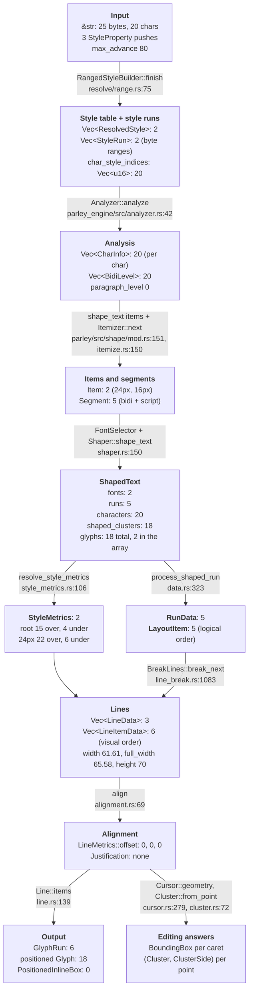
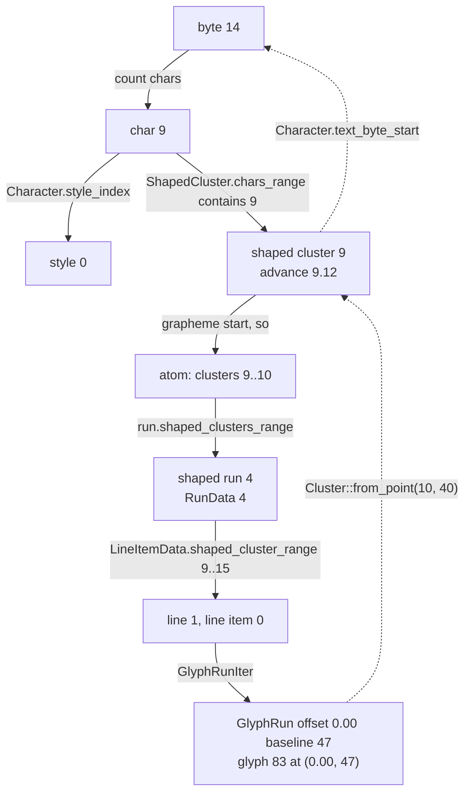

# Data flow on one page

This chapter is the [walkthrough](walkthrough.md) compressed into one picture and one table: what goes in, what shape the data has after every stage, and what comes out. Use it as a map while reading the walkthrough, or on its own when you need to remember which `Vec` a given index points into.

Everything here is the walkthrough's string at width 80. All counts come from `scratch/walkthrough-80.out`.

```text
input text:  "Hi مرحبا office!\nBye"      25 bytes, 20 chars
styles:      font-family Roboto, Noto Kufi Arabic; font-size 16; font-size 24 on bytes 0..2
width:       80
```

## The picture

Boxes are data. Arrows are the functions that produce the next piece of data. Counts are for this string.



The dashed line between the two phases of the [overview](overview.md#the-pipeline) falls between `RunData` and `Lines`: everything above it is computed once by `build`, everything below it is recomputed by `break_all_lines` and `align`.

## The table

| # | Stage | Function | Data produced | Count here | Indexed by |
|---|---|---|---|---|---|
| 0 | input | you | `&str`, `StyleProperty` pushes | 25 bytes, 20 chars, 3 pushes | bytes |
| 1 | style resolution | `RangedStyleBuilder::finish` | `Vec<ResolvedStyle>` (style table) | 2 | style index `u16` |
| | | | `Vec<StyleRun>` | 2: `(1, 0..2)`, `(0, 2..25)` | bytes |
| | | `build_into_layout` | `char_style_indices: Vec<u16>` | 20: `1 1 0 0 0 ... 0` | char |
| 2 | analysis | `Analyzer::analyze` | `Vec<CharInfo>` | 20 | char |
| | | | `Vec<BidiLevel>` | 20: `0 0 0 1 1 1 1 1 0 ... 0` | char |
| 3 | itemization | `shape_text` (parley) | `Item` | 2: `char_end 2` at 24px, `char_end 20` at 16px | char |
| | | `Itemizer::next` | `Segment` | 5 | char + byte ranges |
| 4 | shaping | `Shaper::shape_text` | `ShapedText::fonts` | 2 (Roboto, Noto Kufi Arabic) | font index |
| | | | `ShapedText::runs` | 5 | run index |
| | | | `ShapedText::characters` | 20 | char |
| | | | `ShapedText::shaped_clusters` | 18 | cluster index `u32` |
| | | | `ShapedText::glyphs` | 2 stored (16 more are inline in clusters) | glyph index |
| 5 | style metrics | `resolve_style_metrics` | `Vec<StyleMetrics>` | 2 | style index |
| 6 | run data | `process_shaped_run` | `Vec<RunData>`, `Vec<LayoutItem>` | 5, 5 | run index, item index |
| 7 | line breaking | `BreakLines::break_next` | `Vec<LineData>` | 3 | line index |
| | | `commit_line` | `Vec<LineItemData>` | 6 | line item index |
| | | `finish_line` | `LineMetrics` per line | baselines 22, 47, 66 | |
| 8 | alignment | `align` | `LineMetrics::offset`, `LineData::justification` | 0, 0, 0; none | line index |
| 9 | output | `Line::items` | `GlyphRun` | 6 (4 + 1 + 1) | style-aligned cluster range |
| | | `GlyphRun::positioned_glyphs` | `Glyph` with absolute x, y | 18 | |
| 10 | editing | `Cursor::geometry` | `BoundingBox` | one per query | bytes in, pixels out |
| | | `Cluster::from_point` | `(Cluster, ClusterSide)` | one per query | pixels in, bytes out |

## The data at each stage, side by side

The same information as the walkthrough, cut down to one block per stage so you can see the shape change.

**0. Input**

```text
"Hi مرحبا office!\nBye"
push_default FontFamily ["Roboto", "Noto Kufi Arabic"]
push_default FontSize 16
push FontSize 24 on bytes 0..2
```

**1. Style table and runs** (bytes)

```text
style table   0: Roboto stack, 16px, parent 0        1: Roboto stack, 24px, parent 0
style runs    (style 1, bytes 0..2)  (style 0, bytes 2..25)
per char      1 1 0 0 0 0 0 0 0 0 0 0 0 0 0 0 0 0 0 0
```

**2. Analysis** (chars)

```text
char   0 1 2 3 4 5 6 7 8 9 10 11 12 13 14 15 16 17 18 19
text   H i _ م ر ح ب ا _ o f  f  i  c  e  !  \n B  y  e
script L L C A A A A A C L L  L  L  L  L  C  C  L  L  L      (L Latn, A Arab, C Common)
bidi   0 0 0 1 1 1 1 1 0 0 0  0  0  0  0  0  0  0  0  0
wrap   . . . Y . . . . . Y .  .  .  .  .  .  .  .  .  .      (soft wrap opportunity before)
```

**3. Items and segments** (chars)

```text
items      [0..2) 24px   [2..20) 16px
segments   [0..2) Latn 0   [2..3) Latn 0   [3..8) Arab 1   [8..9) Arab 0   [9..20) Latn 0
```

**4. ShapedText** (chars, clusters, glyphs)

```text
run  chars   clusters  font            size bidi  cluster advances
0    0..2    0..2      Roboto          24   0     17.11 5.82
1    2..3    2..3      Roboto          16   0     3.96
2    3..8    3..8      Noto Kufi       16   1     9.18 5.74 9.28 5.46 5.06
3    8..9    8..9      Noto Kufi*      16   0     5.44
4    9..20   9..18     Roboto          16   0     9.12 13.66(ffi) 8.38 8.48 4.12 0.00(\n) 9.96 7.47 8.48
```

`*` The probe's simplified font selector; Parley's real selector gives this space Roboto and 3.96, which is what the line data below uses.

**5. Style metrics** (style index)

```text
style 0: ascent 15 descent 4  over 15 under 4   (the strut)
style 1: ascent 22 descent 6  over 22 under 6
```

**6. Run data and items** (run index)

```text
items (logical)   run0  run1  run2  run3  run4        all TextRun, no out-of-flow boxes
```

**7. Lines** (line index, line item index, narrowed cluster ranges)

```text
line 0  text  0..14 "Hi مرحبا "   items 0..4   Regular   baseline 22  box  0..32  advance 65.58  hanging 3.96
   item 0 run 0 clusters 0..2    item 1 run 1 clusters 2..3    item 2 run 2 clusters 3..8 (rtl)    item 3 run 3 clusters 8..9
line 1  text 14..22 "office!\n"   items 4..5   Explicit  baseline 47  box 32..51  advance 43.75  hanging 0
   item 4 run 4 clusters 9..15
line 2  text 22..25 "Bye"         items 5..6   None      baseline 66  box 51..70  advance 25.91  hanging 0
   item 5 run 4 clusters 15..18
layout  width 61.61  full_width 65.58  height 70
```

Run 4 appears twice, once per line, each time narrowed to its clusters on that line. That is the only place where one shaped run becomes two pieces.

**8. Alignment** (line index)

```text
offset  0 0 0        justification  none none none        (Start alignment, LTR)
```

**9. Output** (per line, visual order)

```text
line 0  GlyphRun style 1 offset  0.00 baseline 22  glyphs 44@0.00 77@17.11
        GlyphRun style 0 offset 22.93 baseline 22  glyphs 4@22.93
        GlyphRun style 0 offset 26.89 baseline 22  glyphs 9@26.89 309@34.61 15@31.95 26@37.41 30@46.69 84@52.43
        GlyphRun style 0 offset 61.61 baseline 22  glyphs 4@61.61
line 1  GlyphRun style 0 offset  0.00 baseline 47  glyphs 83@0.00 446@9.12 71@22.78 73@31.16 5@39.63
line 2  GlyphRun style 0 offset  0.00 baseline 66  glyphs 38@0.00 93@9.96 73@17.43
```

A renderer needs nothing beyond this block and `run.font()`.

**10. Editing**

```text
Cursor byte 14 downstream -> x 0.00  y 32..51     (start of "office", line 1)
Cursor byte 16 downstream -> x 13.68 y 32..51     (inside the ffi ligature, one third in)
point (10, 40)            -> cluster bytes 15..16 "f", side Left
```

## Following one character through every index

Take the `o` of `office`, byte 14. This is the path a hit test or a caret query takes, in both directions.



Forward (byte to pixel) is what `Cursor::geometry` does; backward (pixel to byte) is `Cluster::from_point` followed by `text_range()`. Both pass through the shaped cluster, because that is the only place where the character array and the glyph array meet.
