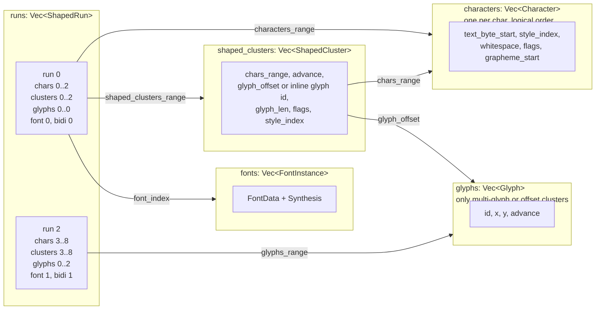
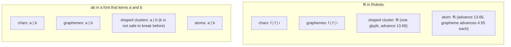
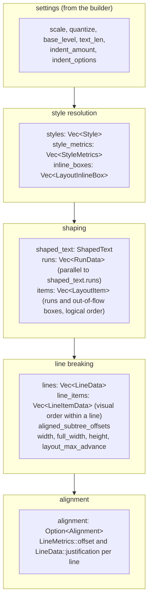
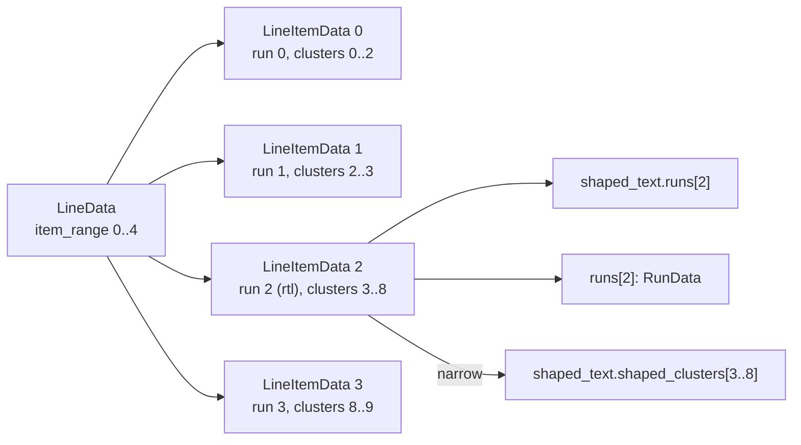
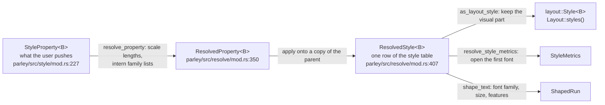

# Core data structures

After this chapter you can look at any index in Parley's code and say which array it points into, explain the difference between a shaped cluster, a grapheme, an atom and a `Cluster`, and draw how a `Layout` is laid out in memory.

Parley stores almost everything in flat `Vec`s and connects them with integer indices and ranges, not with references or pointers. This is common in Rust (it keeps the borrow checker happy and the memory contiguous) and it is the main thing to get used to. Think of it as a relational database with a handful of tables, where every row is small and every relation is a range of row numbers.

## The index spaces

| Index | Unit | Type | Where it comes from | Who uses it |
|---|---|---|---|---|
| byte | one UTF-8 byte of the source string | `usize` | the `&str` | public API: `text_range()`, `Cursor::index`, `InlineBox::index`, style ranges |
| character | one `char` (Unicode scalar value) | `u32` / `usize` | analysis | `Analysis::char_info`, `ShapedText::characters`, `ShapedCluster::chars_range`, `Atom::char_range` |
| shaped cluster | one `ShapedCluster` | `u32` | shaping | `ShapedRun::shaped_clusters_range`, `LineItemData::shaped_cluster_range`, `BreakerState::cluster_idx` |
| glyph | one `Glyph` | `usize` / `u32` | shaping | `ShapedRun::glyphs_range`, `ShapedCluster::glyph_offset` |
| font | one `FontInstance` | `usize` | shaping | `ShapedRun::font_index` |
| style | one entry of the style table | `u16` | style resolution | `Character::style_index`, `ShapedCluster::style_index`, `Style::parent`, `StyleMetrics::aligned_subtree_root` |
| shaped run / run | one `ShapedRun` and its `RunData` twin | `usize` | shaping | `LayoutItem::index`, `LineItemData::index` |
| layout item | one `LayoutItem` (a run or an out-of-flow box) | `usize` | shaping | `BreakerState::item_idx`, `LineState::items` |
| line | one `LineData` | `usize` / `u32` | line breaking | `Layout::get`, `ClusterPath::line_index` |
| line item | one `LineItemData` | `usize` | line breaking | `LineData::item_range` |

Three rules keep this manageable:

1. **Character indices are absolute** into `ShapedText::characters`, which has exactly one entry per `char` of the source text in logical order (`parley_engine/src/shape/shaped_text.rs:256`). So a character index is also a position in the string, counted in chars. `ShapedSlice::text_byte_range` (`parley_engine/src/shape/atom.rs:99`) converts a char range to bytes by reading `Character::text_byte_start`.
2. **Shaped cluster indices are absolute** into `ShapedText::shaped_clusters`. A `ShapedSlice` (`parley_engine/src/shape/atom.rs:18`) is a `(start, end)` pair of them plus borrowed references to the three arrays it indexes (`characters`, `shaped_clusters`, `glyphs`); narrowing a slice only changes the pair.
3. **Style indices are `u16`** and index the style table, whose entry 0 is the root style. The table is ordered parent-first: `style.parent < index` for every non-root style (`parley/src/layout/style_metrics.rs:103`).

## The shaping output: `ShapedText`

`ShapedText` (`parley_engine/src/shape/shaped_text.rs:148`) is a set of parallel vectors. One `ShapedRun` points into each of them with a range.

The field-level details:

- `Character` (`parley_engine/src/shape/data.rs:15`): `text_byte_start`, `style_index`, a `Whitespace` class, `CharacterFlags` (emoji, word boundary, soft wrap opportunity, inline object, default ignorable, UTF-8 length, packed into a `u8`), and `grapheme_start`.
- `ShapedCluster` (`parley_engine/src/shape/data.rs:180`): `chars_range`, `style_index` (of its first character), `glyph_offset`, `advance`, and packed flags including `glyph_len`, `has_inline_glyph`, `is_grapheme_start`, `is_safe_to_break_before`, `is_safe_to_concat_before`, `is_inline_object`, and cached copies of the first character's soft-wrap bit and whitespace class so that measuring never has to touch the character array.
- `ShapedRun` (`parley_engine/src/shape/shaped_text.rs:456`): the `TextRange` (both bytes and chars), `font_size`, `font_index`, the three ranges, the normalized variation coordinates and features it was shaped with, `bidi_level`, `script`, `language`, and a `FontMetrics` (ascent, descent, leading, underline and strikethrough metrics, x-height, cap-height) already scaled to the font size.
- `Glyph` (`parley_engine/src/glyph.rs:7`): `id`, `x`, `y` offsets and `advance`, in layout units. The y axis points down, which is the opposite of font space; the flip happens at `parley_engine/src/shape/shaped_text.rs:618`.

Glyphs within each cluster of a right-to-left run are stored in **paint order** (`parley_engine/src/shape/shaped_text.rs:423`). The clusters and their glyph groups are stored in logical order; the reading API walks the clusters backwards to produce paint order across the run (`parley/src/layout/run.rs:332`).

## Shaped cluster, grapheme, atom, `Cluster`

Four words that all mean "a small group of characters" and that mean different things. This is the most important distinction in Parley; `#715` introduced it in August 2026.

| Term | Defined by | Edges are | Used for | Type |
|---|---|---|---|---|
| **grapheme** (cluster) | Unicode UAX 29, text only | what a user thinks of as one character | caret movement, selection, hit testing | `Grapheme` (`parley_engine/src/shape/atom.rs:808`) |
| **shaped cluster** | the font, via HarfBuzz | groups of characters whose glyphs cannot be told apart | drawing, measuring | `ShapedCluster` |
| **atom** | both: the smallest span whose edges are grapheme *and* shaped cluster edges | the smallest unit a line can break at without reshaping | line breaking, spacing, glyph runs | `Atom` (`parley_engine/src/shape/atom.rs:481`) |
| **`Cluster`** (in `parley`) | a grapheme inside one `Run` on one line | one grapheme | the public editing API | `Cluster` (`parley/src/layout/cluster.rs:24`) |

A worked example with two strings. `ffi` is three graphemes but Roboto has a single `ffi` glyph, so it is one shaped cluster. `e` followed by a combining acute accent (U+0301) is one grapheme; with the monotone-characters cluster level Parley asks HarfRust for (`parley_engine/src/shape/shaper.rs:340`), it can still be one shaped cluster or two, depending on the font. The test `select_atom_at` in `parley_engine/src/shape/atom.rs:939` shows the first case.

The rules, in code:

- A **grapheme** walks characters by `Character::grapheme_start` (`Graphemes::next`, `parley_engine/src/shape/atom.rs:670`). When a grapheme covers only part of a shaped cluster, it gets an even share of that cluster's advance: `cluster.advance / graphemes_overlapped` (`partial_advance_at`, `atom.rs:324`). That is why each third of `ffi` is 4.55.
- An **atom** walks shaped clusters and stops at the next cluster whose `is_grapheme_start` is true (`Atoms::next`, `atom.rs:443`). Its advance is the sum of its clusters' advances.
- `ShapedSlice::atoms_from(cluster)` must be given an atom boundary; `narrow()` must be given atom-aligned bounds. Both are `debug_assert`ed (`atom.rs:196`, `atom.rs:282`).

Why do atoms exist at all? The line breaker needs to move whole glyphs between lines, so it cannot split a shaped cluster. The caret needs to stop between graphemes, and a grapheme can start in the middle of a shaped cluster (ligatures) or span several (some fonts split base and mark). The atom is the unit that satisfies both: inside an atom nothing can be broken; between atoms, both the glyphs and the text are cleanly separable. Letter spacing is also applied per atom, because inserting space inside a ligature is impossible without reshaping (`parley/src/layout/spacing.rs:22`).

A `parley::Cluster` is a grapheme seen from the layout: it holds a `Run`, the `Atom` containing the grapheme, and the `Grapheme` (`parley/src/layout/cluster.rs:24`). The old names survive in its API: `is_ligature_start()` means "this grapheme starts an atom but does not end it", and `is_ligature_continuation()` means "this grapheme does not start an atom" (`cluster.rs:197`). All of a ligature's glyphs belong to its first grapheme; the continuations yield none (`cluster.rs:240`).

## The layout: `LayoutData`

`Layout<B>` is a thin wrapper around `LayoutData<B>` (`parley/src/layout/data.rs:190`). The fields are grouped by which stage writes them:

- `Style<B>` (`parley/src/layout/mod.rs:50`) is the **visual** subset of a resolved style that survives into the layout: brush, decorations, line height, vertical align, overflow wrap, text wrap mode, whitespace collapse, locale, and `parent`. Font family, size, weight and so on are not here; they already did their job during shaping and live on the shaped runs.
- `StyleMetrics` (`parley/src/layout/style_metrics.rs:69`) is the span box of one style: ascent, descent, x-height, `over` and `under` (the line-height-expanded extents), `baseline_offset` from `vertical-align`, the `aligned_subtree_root`, `parent` and `font_size`.
- `RunData` (`parley/src/layout/data.rs:21`) is `parley`'s addition to a `ShapedRun`: the requested font attributes (for accessibility), the synthesis flags, the resolved line height, the `Spacing` (word and letter spacing), the run's box metrics if uniform, and `has_mixed_style_atoms`.
- `LayoutItem` (`data.rs:180`) is the unit the line breaker iterates: either a text run (index into `runs`) or an out-of-flow box (index into `inline_boxes`), with a bidi level.
- `LineData` (`data.rs:81`): the line's byte range, its `item_range` into `line_items`, `LineMetrics`, `break_reason`, `max_advance`, the number of justification opportunities, the per-line `Justification`, and its slice of `aligned_subtree_offsets`.
- `LineItemData` (`data.rs:148`): one run or out-of-flow box on one line. For a run it narrows the run to this line with `shaped_cluster_range` (atom-aligned) and `text_range`. A shaped run that is split over two lines appears as two line items.

The relationship between a line and the shaped data:

`line_items` within one line are in **visual** order after `reorder_line_items`; `items` are always in logical order.

## Styles, three times over

A style property is represented three times on its way into a layout:

`TextStyle` (`parley/src/style/mod.rs:284`) is the struct form of a full set of properties, used by `TreeBuilder` and `StyleRunBuilder`; `StyleProperty` is the enum form, one property at a time, used by `RangedBuilder`. `StyleSet` (`parley/src/style/styleset.rs:18`) is a map from property kind to property, used only by `PlainEditor`.

`ResolveContext` (`parley/src/resolve/mod.rs:126`) interns three kinds of lists so that styles can be compared cheaply: font family lists (`Vec<FamilyId>`), variations and features. A `Resolved<T>` handle (`mod.rs:49`) is just an index into the matching cache; two styles with the same family list get the same handle, and `FontSelector` checks `style.font_family.id()` to skip re-querying fontique (`parley/src/shape/mod.rs:329`).

The **style runs** (`StyleRun`, `parley/src/resolve/mod.rs:36`) are `(style_index, byte range)` pairs covering the text. They exist only during build. `LayoutContext` keeps them (`parley/src/context.rs:30`) and they are flattened into `char_style_indices` before shaping.

## The public views

The types a user touches are cheap, copyable views over the data above. They borrow the `Layout` and hold indices.

| View | Holds | Created by | File |
|---|---|---|---|
| `Line<'a, B>` | `&Layout`, line index, `&LineData` | `Layout::lines()`, `Layout::get()` | `parley/src/layout/line.rs:19` |
| `Run<'a, B>` | `&Layout`, line index, index within line, shaped run index, `&ShapedRun`, `&RunData`, `Option<&LineItemData>` | `Line::runs()` | `parley/src/layout/run.rs:19` |
| `Cluster<'a, B>` | `Run`, `Atom`, `Grapheme` | `Run::clusters()`, `Cluster::from_point`, `Cluster::from_byte_index` | `parley/src/layout/cluster.rs:24` |
| `GlyphRun<'a, B>` | `Run`, style index, atom-aligned shaped cluster range, offset, baseline, advance | `Line::items()` | `parley/src/layout/line.rs:283` |
| `PositionedInlineBox` | x, y, width, height, baseline, id, kind | `Line::items()` | `line.rs:267` |
| `ClusterPath` | line index, run index, char index | `Cluster::path()` | `cluster.rs:494` |

A `Run` with `line_data: None` is the whole shaped run; with `Some`, it is narrowed to one line (`Run::line_slice`, `run.rs:72`). The line breaker uses the first form, everything after it the second.

`Run::clusters()` walks graphemes and atoms in lockstep (`Clusters`, `run.rs:365`). `Run::len()` and `Run::cluster_range()` count graphemes and so are linear in the run's length (`run.rs:169`); do not call them in a loop.

## Editing types

- `Cursor` (`parley/src/editing/cursor.rs:10`) is a byte index plus an `Affinity`. `Downstream` means the caret belongs to the character after the index, `Upstream` to the one before. The distinction only shows at line ends and direction changes, as the walkthrough's bytes 3 and 13 showed.
- `Selection` (`parley/src/editing/selection.rs:14`) is an anchor `Cursor` and a focus `Cursor`, plus an `AnchorBase` (cluster, word or line granularity for drag-selection) and a remembered horizontal position for up and down movement.
- `PlainEditor<B>` (`parley/src/editing/editor.rs:87`) owns a `String`, a `Layout`, a `Selection`, an IME compose range and a `Generation` counter. `PlainEditorDriver` (`editor.rs:151`) bundles the editor with the two contexts so that operations needing a fresh layout can refresh it first.

## What is deliberately not stored

- There is no per-glyph style index. `Glyph::style_index` was removed in `#661`; the style comes from the cluster or glyph run.
- There is no per-line copy of glyphs. `GlyphRun` positions glyphs on the fly by adding the line's offset and the running advance (`GlyphRun::positioned_glyphs`, `line.rs:345`).
- There is no "logical to visual" map. `#810` removed `Run::logical_to_visual`; use `visual_clusters()` or `Cluster::next_visual()`.
- Letter spacing, word spacing and justification are not in any advance field. They are added by `EffectiveSpacing` when read (`parley/src/layout/spacing.rs:167`). See [invariants](invariants.md).
