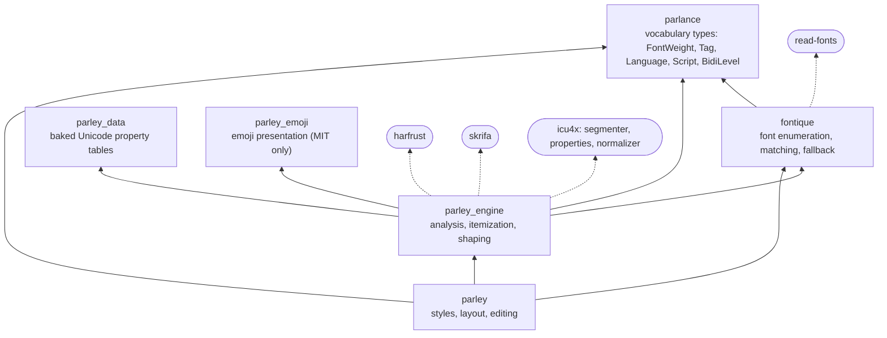
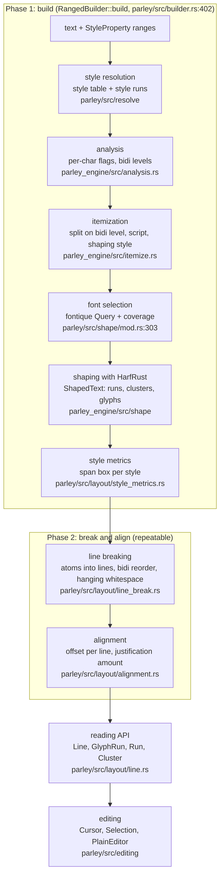

# Overview and mental model

After this chapter you can name Parley's crates and what each one is for, draw the pipeline from a string to positioned glyphs, and explain how Parley relates to the layout engine in a browser.

## What Parley is

Parley takes a paragraph of text with styles and produces a `Layout`: a list of lines, each holding glyph runs and inline boxes with final positions. The crate doc comment in `parley/src/lib.rs:7` lists the key types:

- `FontContext` (`parley/src/font.rs:12`): the font database. A wrapper around a fontique `Collection` and a `SourceCache`. Make one per application.
- `LayoutContext` (`parley/src/context.rs:26`): scratch space that is reused between layouts so that building a layout does not allocate much. Make one per application or per thread.
- Three builders (`parley/src/builder.rs`): `RangedBuilder` (styles as ranges over a flat string, like `push(FontWeight::BOLD, 0..4)`), `TreeBuilder` (styles as a nested tree of spans, like HTML, with whitespace collapsing) and `StyleRunBuilder` (you hand over a finished style table and non-overlapping runs).
- `Layout` (`parley/src/layout/layout.rs:25`): the result. It can be re-broken at a new width and re-aligned many times, but if the text or styles change you build a new one.

The smallest possible program, taken from `parley/src/lib.rs:35`, is:

```rust
let mut font_cx = FontContext::new();
let mut layout_cx = LayoutContext::new();
let text = "Lorem ipsum";
let mut builder = layout_cx.ranged_builder(&mut font_cx, text, 1.0, true);
builder.push_default(StyleProperty::FontSize(16.0));
builder.push(StyleProperty::FontWeight(FontWeight::new(600.0)), 0..4);
let mut layout: Layout<()> = builder.build(text);
layout.break_all_lines(Some(100.0));
layout.align(Alignment::Start, AlignmentOptions::default());
for line in layout.lines() {
    for item in line.items() {
        match item {
            PositionedLayoutItem::GlyphRun(run) => { /* paint glyphs */ }
            PositionedLayoutItem::InlineBox(b) => { /* paint the box */ }
        }
    }
}
```

The two arguments `1.0, true` are the display scale (for HiDPI, like `devicePixelRatio`) and `quantize` (round vertical font metrics and line box edges to whole pixels; see [the limits](invariants.md#quantize-and-scale)). Every number this guide prints was produced with scale 1 and quantize on, which is what the examples and tests use.

## What Parley is not

- **Not a renderer.** Parley gives you glyph ids and positions. Drawing them is the job of Vello, tiny-skia, Swash or your own code. The `examples/` folder shows three renderers.
- **Not a document model.** `PlainEditor` (`parley/src/editing/editor.rs:87`) is a convenience that keeps one string and one `Layout` in sync for a text field. Rich text editing, undo and storage are yours.
- **Not a block layout engine.** A `Layout` is one block of inline content. Floats, margins, columns and page flow belong to the caller (Blitz, Masonry and Xilem do this on top of Parley). The low-level `BreakLines` API lets a caller lay out around excluded regions and floats, one line at a time.
- **Not a font rasterizer.** Fonts are read by [skrifa](https://github.com/googlefonts/fontations) for metrics and shaped by HarfRust. Outlines and bitmaps are the renderer's business.

## How Parley compares

Parley follows the CSS inline layout model closely, because its main users (the Blitz browser engine and the Masonry UI toolkit) need web-compatible results. This table is from general knowledge of the other engines, not from reading their source; treat it as orientation.

| | Browser inline layout (Blink, Gecko) | Pango | CoreText | SkParagraph (Skia, Flutter) | Parley |
|---|---|---|---|---|---|
| Language | C++ | C | Objective-C / C | C++ | Rust, `no_std` + `alloc` |
| Input | DOM + computed CSS | marked-up string + attributes | attributed string | paragraph style + text styles | string + `StyleProperty` ranges or tree |
| Shaping | HarfBuzz | HarfBuzz | Apple's shaper | HarfBuzz | HarfRust (Rust port of HarfBuzz) |
| Unicode data | ICU | GLib / fribidi | Apple | ICU | ICU4X + baked tables in `parley_data` |
| Font fallback | per browser | fontconfig | CoreText | font manager | fontique (platform backends + registered fonts) |
| Line breaking | greedy, CSS Text 3/4 | greedy, UAX 14 | greedy | greedy | greedy, UAX 14 + CSS Text 4 rules, optional Chromium override table |
| Editing helpers | editing host | cursor APIs | CTLine hit testing | cursor and selection APIs | `Cursor`, `Selection`, `PlainEditor` |
| Can match Chrome's breaks? | is Chrome | no | no | no | yes, tested (`parley_tests/tests/linebreaking_matches_chrome.rs`) |

The closest analogy for a web engineer: Parley is the part of a browser that turns the text inside one block into line boxes, with `LayoutNG`-style inline layout, but as a library you can call from Rust with no DOM.

## The crates

The workspace (`Cargo.toml:3`) has these members. Arrows mean "depends on".



Dashed arrows are the important external crates. The main remaining workspace members are tooling, not published (two more, `parley_tests/linebreaking_cases` and `parley_tests/linebreaking_browser_recorder`, generate and record the Chrome line-break comparison data; see `Cargo.toml:15`):

| Crate | Purpose | Where |
|---|---|---|
| `parley_dev` | Test fonts (Roboto, Arimo, Noto Kufi Arabic, a Noto Color Emoji subset) and text samples | `parley_dev/src/lib.rs:11` |
| `parley_tests` | Integration and snapshot tests | `parley_tests/tests/mod.rs` |
| `parley_bench` | Benchmarks (tango-bench) | `parley_bench/benches/main.rs` |
| `parley_data_gen` | Regenerates the tables in `parley_data` from ICU4X data | `parley_data_gen/src/main.rs` |
| `attributed_text` | An attributed string crate, `publish = false`, not yet used by Parley | `attributed_text/src/lib.rs` |
| `xtask` | `cargo xtask report / review / dead-snapshots` for snapshot tests, via Kompari | `xtask/src/main.rs` |
| `examples/*` | `swash_render`, `tiny_skia_render`, `vello_cpu_render`, `editor`, `external_dictionaries` | `examples/` |

The split between `parley` and `parley_engine` is recent (July 2026, `#705`). The engine is for callers who want to do their own line breaking, such as a typesetter; it knows nothing about CSS styles. `parley` is the web-style layer on top. The README of 0.12.0 says the engine "analyzes paragraphs of text, resolving details like line break opportunities, grapheme boundaries, bidirectional text embedding levels, and emoji presentation, and shapes them with caller-provided font selection. Layout decisions, such as where to break lines and how to align or stack them, are left to the caller."

## The pipeline

Everything happens in two phases. **Build** is expensive and depends on fonts. **Break and align** is cheap and can be repeated at any width.



In CSS terms: phase 1 is style computation plus shaping, which a browser does once per text node. Phase 2 is what happens when the containing block's width changes: lines are recomputed, glyph advances are not.

A useful rule that the code enforces everywhere: **shaped advances never change after shaping**. Letter spacing, word spacing and justification are added when you read a `Cluster` or `GlyphRun`, not written into the glyph data (`parley/src/layout/spacing.rs:167`). The [invariants chapter](invariants.md) explains why.

## A short history

Knowing the history explains some names and leftovers.

| When | What | Commit or PR |
|---|---|---|
| June 2021 | Repository created with a design and concept document (`doc/design.md`, `doc/concept.md`). The plan was swash for shaping and the piet text API. | `84b1c3e`, `db035bb` |
| May 2024 | Split into several crates; fontique appears. | `#59` |
| August 2025 | Shaping moved from swash to HarfRust. | `#400` |
| December 2025 | Text analysis moved from swash to ICU4X; `parley_data` baked tables. | `#436` |
| July 2025 | `parley_core` added as a lower-level crate. | `#388` |
| July 2026 | `parley_core` renamed `parley_engine`; `ShapedText` becomes the shaping output. | `#705`, `#679` |
| July 2026 | Line box sizing follows CSS 2.2 section 10.8. | `#697` |
| August 2026 | Shaped clusters, graphemes and atoms distinguished; `Cluster` spans a grapheme. | `#715` |
| August 2026 | Spacing and justification applied on read instead of mutating advances. | `#738` |
| September 2026 | CSS Text 4 whitespace hanging, `white-space-collapse` as a style, `vertical-align`, `line-break`. | `#762`, `#790`, `#814`, `#766`, `#843` |
| October 2026 | 0.12.0 released. In-flow inline boxes become U+FFFC characters. | `#888`, `#902` |

The concept document from 2021 (`doc/concept.md`) walks the string "We will meet at 09:35 at the beach" through the same stages this guide uses. The stage names have not changed in five years; the implementation under them has changed completely.
